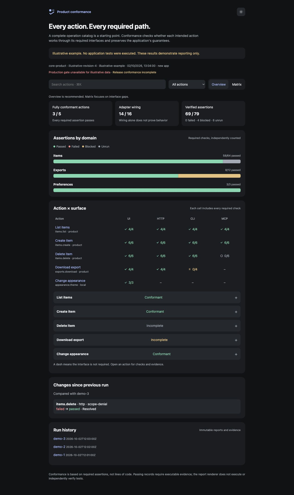

# Agent-Native Product Spine: an app architecture skill for Claude Code, Codex, Cursor and Grok

**Agent-Native Product Spine** is an open-source agent skill, `app-architecture-rules`, that teaches coding agents to build and review **agent-native applications**. You define each product action once. The web UI, HTTP API, CLI and MCP tools then call the same operation, with the same validation, permissions and scope.

It packages [Agent-Native Spine](https://anson.sh/work/agent-native-spine/) (formerly Product Spine), the architecture [Anson Cheung](https://anson.sh/) uses across his products. Read the overview, the instructions and every file on the **[app-architecture-rules skill page on anson.sh](https://anson.sh/agent-skills/app-architecture-rules/)**.



## Install

Clone this repository into your agent's skills folder. Run `git pull` in that folder later to update the skill.

**Claude Code**

```bash
git clone --depth 1 https://github.com/Ansonhkg/agent-native-product-spine.git ~/.claude/skills/app-architecture-rules
```

**Codex**

```bash
git clone --depth 1 https://github.com/Ansonhkg/agent-native-product-spine.git ~/.codex/skills/app-architecture-rules
```

**Cursor**

```bash
git clone --depth 1 https://github.com/Ansonhkg/agent-native-product-spine.git ~/.cursor/skills/app-architecture-rules
```

**Grok**

```bash
git clone --depth 1 https://github.com/Ansonhkg/agent-native-product-spine.git ~/.grok/skills/app-architecture-rules
```

**Ask your agent to install it.** Paste this into Claude Code, Codex, Cursor, Grok or another coding agent:

> Install the app-architecture-rules skill: clone https://github.com/Ansonhkg/agent-native-product-spine into your skills directory as app-architecture-rules, then confirm that it loads.

## Use

The agent loads the skill when you create, extend, migrate or review an app. You can also ask for it by name:

- "Use app-architecture-rules to plan this app so that people and agents use the same operations."
- "Use app-architecture-rules to review this app's action coverage across the UI, HTTP API, CLI and MCP."
- "Use app-architecture-rules to add `task.archive` to every interface, with conformance checks."

## What the skill gives your agent

- **One execution path.** UI, HTTP, CLI and MCP adapters stay thin and resolve to one shared operation. Catalog metadata never runs domain logic.
- **A trusted host.** The host owns authentication, permissions, scope, validation and persistence. Client input cannot grant authority.
- **Operation contracts.** Stable IDs, input, output and error schemas, mutation classification, scope rules and surface bindings for every operation.
- **Atomic mutations.** Each change runs through an explicit validate-to-persist workflow, with revision checks and atomic commits.
- **Durable workflows.** Long-running work has checkpoints and declared recovery behaviour.
- **Agent-readable documentation.** A catalog-backed API documentation page and `/llms.txt`, generated from the same contracts.
- **Executable conformance.** An independent action inventory, a check for every action, interface and requirement, and an HTML report for each run. A catalog entry or a named test alone never counts as a pass.

## Rules at a glance

| ID | Rule |
| --- | --- |
| ARCH-001 | One execution path for every product operation |
| ARCH-002 | The host owns authority and state |
| ARCH-003 | Stable operation contracts |
| ARCH-004 | Explicit, atomic mutation workflows |
| ARCH-005 | Effect v4 for effectful application logic |
| ARCH-006 | TanStack Query for client server state |
| ARCH-007 | Versioned, recoverable long-running workflows |
| ARCH-008 | Structured execution telemetry |
| ARCH-009 | Isolated untrusted extensions |
| ARCH-010 | Checked activation of versioned artifacts |
| ARCH-011 | Atomic background and cross-app delivery |
| ARCH-012 | Independent action inventory and conformance profile |
| ARCH-013 | API documentation page and `/llms.txt` |
| ARCH-014 | Slash-separated URLs for navigation and deep links |

The full requirements and verification steps are in [rules.md](rules.md).

## What is inside

| File | Purpose |
| --- | --- |
| [SKILL.md](SKILL.md) | The workflow the agent follows |
| [rules.md](rules.md) | The ARCH rules and how to verify each one |
| [contracts.md](contracts.md) | Operation, execution, persistence, event and navigation contracts |
| [conformance.md](conformance.md) | Action inventory, required checks, evidence and the gate policy |
| [documentation.md](documentation.md) | The API documentation page and `llms.txt` requirements |
| [examples.md](examples.md) | Architecture diagrams and operation examples |
| [scripts/report.py](scripts/report.py) | A Python 3 standard-library conformance reporter |
| [examples/tasks-app](examples/tasks-app/) | A runnable Tasks app with a web UI, HTTP API, CLI and MCP server |
| [examples/fresh-context-trial.md](examples/fresh-context-trial.md) | A trial in which an agent with no prior context built the Tasks app from this skill |

## Proof that it works

An agent with no conversation history built the [example Tasks app](examples/tasks-app/) from this skill alone. Its verification drives real HTTP requests, CLI subprocesses, MCP clients and a Chromium UI. An independent review found two defects in the first pass: a request with a foreign Host header received a session, and a malformed URL crashed the host. After the fix, the app passed **51 of 51** conformance obligations. The [trial write-up](examples/fresh-context-trial.md) records both runs, including the failures.

## Requirements

- A coding agent that supports skills, such as Claude Code, Codex, Cursor or Grok.
- Python 3 for the conformance reporter.
- Node.js 22.13 or later to run the example Tasks app.

## Learn more

- [app-architecture-rules on anson.sh](https://anson.sh/agent-skills/app-architecture-rules/): overview, instructions and files.
- [Agent-Native Spine](https://anson.sh/work/agent-native-spine/): the architecture behind this skill.
- [One product operation, every interface](https://anson.sh/writing/agent-native-spine/): how the architecture developed.
- [All agent skills by Anson Cheung](https://anson.sh/agent-skills/).

## License

[MIT](LICENSE) © Anson Cheung
