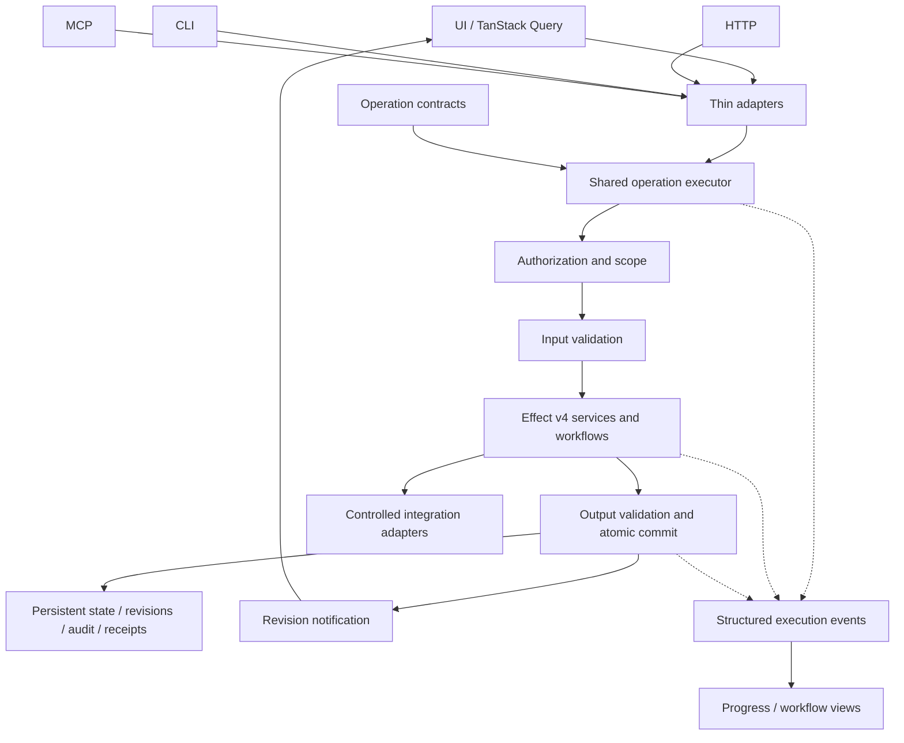

# Generic architecture examples

## Components



## Create an item

UI, CLI, and MCP all invoke `items.create` with the same scope and input contract. The shared executor checks access and validates the request. An Effect service proposes the record. The persistence transaction checks current authority/revision, writes the item and audit record, and stores an idempotency receipt if requested. A revision notification invalidates the open list's TanStack query. A remote-interface test proves that list updates without refresh.

The conformance inventory includes `items.create` even before its handler exists. Every required surface has contract, execution, and applicable authorization assertions; mutations also have atomic persistence and live-update obligations. A missing handler is a failed structural check, not a reason to remove the action from the inventory.

## Documentation projection

The same `items.create` contract supplies the API page's operation row, HTTP schema, CLI usage, MCP tool reference, and JSON catalog entry. The API page explains workspace authorization, expected revision, and idempotency with validated examples. `/llms.txt` links to the page and machine references. A parity check reconciles those outputs with actual adapter registration; example-call tests exercise the shared executor. Neither a generated reference nor an llms.txt link proves an interface works. See documentation.md for the full required profile.

## Illustrative report

`examples/conformance/index.html` demonstrates the report, charts, action/surface matrix, and immutable run directories. Its data is deliberately synthetic and marked illustrative. It proves report rendering only; it cannot establish application conformance.

## Workflow that survives interruption

Use a non-agent batch task to demonstrate durable execution. `examples/durable/counter.ts` defines the task; `examples/durable/worker.ts` opens persistent SQLite storage and durably records one demo run's task ID. It makes no model calls. Effect service and TanStack integration belong to the adopting application's shared operation boundary and are not demonstrated by this standalone example.

The checkpoint and next phase commit together. Repeating the pure calculation before its commit is safe. Output follows the commit and is diagnostic only. The version is included in the task name, and the host must retain that implementation for unfinished runs.

```typescript
import { defineTask } from "@earendil-works/pi-durable";

// The version is part of the name so a later definition cannot replace
// this run's code merely by registering the same task kind.
export const Counter = defineTask<
	{ to: number },
	{ phase: "count"; completed: number },
	number
>({
	name: "example.counter.v1",
	version: 1,
	initial: () => ({ phase: "count", completed: 0 }),
	phases: {
		count: async (task, runtime, context) => {
			// Pure computation is safe to repeat if this phase is interrupted.
			const completed = task.state.checkpoint.completed + 1;
			await runtime.commit(
				() => completed >= task.input.to
					? {
						status: "terminal",
						outcome: { status: "completed", result: completed },
					}
					: {
						status: "running",
						checkpoint: { phase: "count", completed },
					},
				context,
			);
			// Diagnostic output follows the commit; it is not a durable journal.
			console.log(`committed ${completed}`);
			if (completed < task.input.to) {
				await runtime.sleep(runtime.now() + 500, context);
			}
		},
	},
	abort: async (_task, runtime, context) => {
		await runtime.commit(
			() => ({ status: "terminal", outcome: { status: "aborted" } }),
			context,
		);
	},
});
```

Open, admit, and reopen the same task:

```typescript
import { BACKGROUND_CONTEXT } from "@earendil-works/chord/context";
import { createModels } from "@earendil-works/pi-ai/models";
import {
	createRegistry, defineDoc, defineExtension, Harness, type TaskId,
} from "@earendil-works/pi-durable";
import { openNodeSqliteStorage } from "@earendil-works/pi-durable/storage/sqlite/node";
import { Counter } from "./counter.ts";

const Run = defineDoc<{ taskId: TaskId<number> | null }>({
	kind: "example.counter-run",
	version: 1,
	scope: "session",
	initial: () => ({ taskId: null }),
});

const databasePath = process.argv[2];
if (!databasePath) throw new Error("Supply an isolated SQLite path");
const context = BACKGROUND_CONTEXT;
const registry = createRegistry();
registry.install(defineExtension({ name: "counter-v1", tasks: [Counter] }));
const harness = await Harness.open(
	await openNodeSqliteStorage(databasePath),
	{ models: createModels(), registry },
	context,
);

try {
	const root = await harness.root(context);
	// Durable admission: reopening finds the existing task, even if the
	// original caller died before receiving its ID. Scoped demo, one run.
	const id = await root.commit(async (tx) => {
		const run = await tx.doc(Run);
		if (run.taskId === null) {
			run.taskId = await tx.createTask(
				Counter, { to: 5 }, { ownership: { kind: "conversation" } },
			);
		}
		return run.taskId;
	}, context);
	console.log(`task ${id}`);
	console.log("saved", JSON.stringify((await harness.getTask(id, context))?.state));
	if (process.argv[3] === "--abort") {
		await harness.abortTask(id, context);
	}
	const settled = await harness.waitForTask(id, context);
	console.log("outcome", JSON.stringify(settled.state.outcome));
} finally {
	await harness.close(context);
}
```

With the verified package versions installed in an adopting Node app, run `node examples/durable/worker.ts /absolute/isolated/session.sqlite`. Kill that process after `committed 2`, then run the identical command again. The reopened task must report a checkpoint with `completed: 2`, then commit 3, 4, and 5. Opening it again after completion must execute no phases. Use only isolated demo storage and one worker at a time. In a Pi source checkout, preload its source resolver to resolve workspace package imports.

Application integration additionally needs input validation, authorization, scoped idempotent admission, audit policy, bounded execution, progress-to-query-cache bridging, and any external-effect protocol. The counter's one-run document is an admission demo, not a general request receipt implementation.

The example files include a portable verifier. Run `node examples/durable/verify.mjs` after installing the selected dependencies in the adopting app; it uses isolated temporary storage and kills only the child worker it created. To validate against a Pi source checkout with hydrated dependencies, pass its absolute path as the first argument. Explicit abort is demonstrated by running `node examples/durable/worker.ts /absolute/isolated/session.sqlite --abort`; use a pending run, since a completed run remains completed. See [the recovery example README](examples/durable/README.md) for expected output and verification boundaries.
